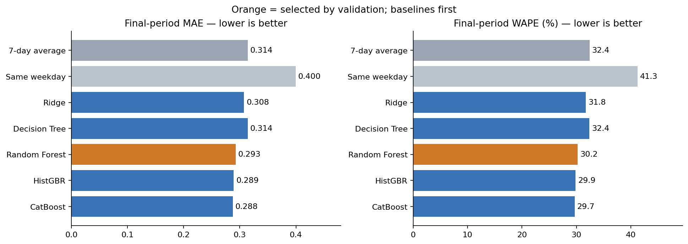

# FreshRetailNet: daily discount decision support

Forecast next-day observed sales for perishable products, then compare candidate discounts under a sales-value constraint. This coursework project uses the public FreshRetailNet-50K dataset, two baselines, five regression models, and a supplementary ensemble experiment.

**Recommended exploratory combination: 50% Random Forest + 50% CatBoost**, selected by mean validation MAE among the tested combinations. In the verified Docker run (7 October 2026): validation MAE **0.30140**, final-week MAE **0.28729**, final-week RMSE **0.45288**. This is a post-hoc extension: the final week had already been viewed, and new dates are needed to confirm the small improvement. The original validation-selected Random Forest and its illustrative discount scenario remain separately reported. The earlier macOS run gave MAE 0.28728; the Docker run has a small numerical difference and the same selected combination. Full environment versions are saved in `outputs/final_protocol/docker_python_packages.txt`.

> **Authorship.** Group coursework for HKU MAIB 7002 (Group Q, three members; their names are on the poster in this repository). This is the team's shared repository. `main` consists of a single upload commit, so the Git history does not record who wrote which part. The dataset is the public FreshRetailNet-50K by Dingdong (CC BY 4.0).



## Results

312 store–product series, five expanding weekly validation folds, one final week of 2,184 store–product-days. Lower is better.

| Method | Mean validation MAE | Final-week MAE | Final-week MASE | Series beating the 7-day baseline |
|---|---:|---:|---:|---:|
| 7-day average baseline | 0.3284 | 0.3142 | 0.785 | – |
| Same-weekday baseline (seasonal naive) | 0.4150 | 0.3998 | 1.002 | 20.8% |
| Ridge Regression | 0.3151 | 0.3075 | 0.785 | 53.8% |
| Decision Tree | 0.3218 | 0.3139 | 0.794 | 52.6% |
| **Random Forest (selected on validation)** | 0.3037 | 0.2929 | 0.747 | 61.5% |
| HistGradientBoosting | 0.3055 | 0.2892 | 0.737 | 63.5% |
| CatBoost | 0.3038 | 0.2878 | 0.739 | 60.9% |
| RF + CatBoost 50/50 (post-hoc supplement) | 0.3014 | 0.2873 | 0.737 | 64.4% |

MASE divides each series' final-week MAE by the error of a same-weekday forecast on that series' own training history, then averages over the 312 series, so a high-volume series does not count for more than a low-volume one.

What the numbers support:

- **The gain over the baseline is real but not universal.** Random Forest's final-week MAE is 6.8% below the 7-day average (difference −0.021, series-level bootstrap 95% interval −0.034 to −0.010), yet it is no better than that baseline on 38% of the series.
- **Random Forest and CatBoost cannot be separated.** Their validation MAE differs by −0.00007 (interval −0.0027 to +0.0026), and on the final week CatBoost is ahead by 0.005 (interval 0.0001 to 0.0106). The 50/50 blend's edge over Random Forest excludes zero on both validation and the final week; its edge over CatBoost does not on the final week.
- **One error margin does not fit every discount level.** An 80% interval built from pooled validation errors covers 82.5% of final-week sales overall but only 63.5% on deep-discount days (discount ≤ 0.80). Calibrating the margin per discount band raises that to 86.7% (81.0% overall); at the 95% level, 87.1% becomes 93.4%.
- **Stock-outs bias the forecast.** On days with 9–16 recorded out-of-stock hours the Random Forest over-forecasts observed sales by 0.136 on average (mean observed sales 0.80); on days with 1–4 hours it under-forecasts by 0.136.

The bootstrap resamples series as independent units although they share the same calendar days, so the intervals understate the uncertainty.

Each number has one command behind it:

| Numbers | Command | Needs |
|---|---|---|
| Validation and final-week MAE, RMSE, WAPE; the 19 ensemble candidates | `python scripts/check_saved_results.py` | a clone (standard library only) |
| MASE, RMSSE, paired intervals, interval coverage, stock-out bias | `python scripts/evaluate_forecast_diagnostics.py` | a clone and `requirements-test.txt` |
| Everything from the raw data: download, 185 fits, audit, report | `python scripts/reproduce.py` | `requirements-models.txt`, about 110 MiB of data |

The first two recompute the tables from the saved row-level predictions; they do not retrain. Details of the diagnostics are in `outputs/forecast_diagnostics/RESULTS.md`.

## Open with Docker

Install and start Docker Desktop (or Docker Engine with Compose), then:

```bash
git clone https://github.com/Lisayinyy/MAIB_7002.git
cd MAIB_7002
docker compose up --build -d
```

Open **[http://localhost:18080](http://localhost:18080)** for the results overview and complete executed notebook report. Saved results are included; no training or dataset download is required to read them. The first image build downloads the Python environment.

For the editable Jupyter notebook, run the following and open its printed login link:

```bash
docker compose exec lab python scripts/jupyter_url.py
```

Jupyter uses port **18888** and a generated login token; it does not share the old port 8888 environment. To download the pinned public data, rerun the full experiment (including ensembles), independently verify it, and refresh the HTML:

```bash
docker compose exec lab python scripts/reproduce.py
```

This overwrites the notebook's executed outputs and current result files in your cloned directory. A full run includes 185 model fits and depends on CPU speed; raw files total approximately 109.6 MiB. To stop: `docker compose down`.

A Dockerfile is the build recipe and needs the repository files as its build context. Share this repository (or its complete ZIP), rather than the Dockerfile alone. See the [Docker guide](docs/DOCKER_GUIDE.md) for alternative ports, persistence and login help, and the [project summary](docs/PROJECT_SUMMARY.md) for the final research narrative.

## Shared repository

The team's shared repository is [Lisayinyy/MAIB_7002](https://github.com/Lisayinyy/MAIB_7002). Use this repository for subsequent project code, notebooks, documentation, and reviewed results.

Teammates can clone this repository into any local directory. Raw public data can be obtained with `scripts/download_public_data.py`; no personal paths or credentials are required.

## Project overview

The main deliverable is `01_freshretail_project.ipynb`. It contains the experiment, results, figures, interpretation, limitations, and a clearly marked supplementary ensemble section. The current experiment reconstructs the teammate's reported data and evaluation protocol while comparing our five models: Ridge Regression, Decision Tree Regressor, Random Forest Regressor, HistGradientBoostingRegressor, and CatBoost Regressor.

This is a **report-based reconstruction**, not an exact reproduction of the teammate's unavailable preprocessing source code. Cohort counts, date ranges, discount-band counts, and reported baseline scores are independently checked in the notebook. The final evaluation week has already been viewed by the team; it is not a previously unseen test set.

## Run the project

Run these commands from the repository root (the directory that contains `01_freshretail_project.ipynb`), in the same Python environment used by the notebook. Python 3.11 or newer is required; the verified run used Python 3.11.14.

```bash
python -m pip install -r requirements-models.txt
python scripts/reproduce.py
```

`requirements-models.txt` pins the directly used packages. To also pin every indirect dependency to the verified Docker environment (Python 3.11), add `-c constraints-docker.txt` to the install command; the Docker image is built this way.

The downloader uses only the Python standard library. It retrieves the official public `train` and `eval` Parquet files at the pinned dataset revision, verifies their SHA-256 hashes, and skips files that already match. Downloads are first written to a temporary file; an existing data file is replaced only after the new file passes verification. Use `python scripts/download_public_data.py --check-only` for an offline integrity check.

For an interactive run, open `01_freshretail_project.ipynb` in JupyterLab, select the Python environment with these dependencies, and use **Kernel → Restart Kernel and Run All Cells**. The command-line runner also executes in a clean `python3` kernel and saves cell outputs back to this notebook. To register the active Python environment as that kernel if necessary:

```bash
python -m ipykernel install --user --name python3 --display-name "Python 3 (FreshRetailNet)"
```

To export the executed notebook as a standalone HTML report:

```bash
python -m nbconvert --to html --embed-images 01_freshretail_project.ipynb --output 01_freshretail_project_report.html
```

The HTML export uses saved notebook outputs. Run the notebook first when fresh results are needed. Rerunning writes updated notebook outputs and files under `outputs/final_protocol/`. The export above is written to the repository root and is ignored by Git; the shipped report is `outputs/final_protocol/01_freshretail_project.html`.

## Frozen experiment protocol

| Item | Current protocol |
|---|---|
| Data | Official FreshRetailNet-50K `train` (2024-03-28–2024-06-25) and `eval` (2024-06-26–2024-07-02); no synthetic sales labels |
| Cohort selection | On all 90 training dates, `discount < 0.95` defines a discounted day; discounted share 15%–85%, zero-sale share <20%, at least six consecutive-day discount-state changes; the first observation is not counted as a change |
| Stores | The five stores with the most eligible series: 343, 18, 235, 182, 154 |
| Cohort size | 312 store–SKU series, 122 products, city 0; 28,080 raw training observations |
| Model-ready training data | 2024-04-04–2024-06-25 after seven warm-up days; 25,896 rows |
| Validation | Five expanding-training weekly folds; validation weeks start 2024-05-22, 05-29, 06-05, 06-12, and 06-19; each has 2,184 rows |
| Final evaluation | 2024-06-26–2024-07-02; 2,184 rows |
| Forecast timing | Rolling one day ahead; earlier observed days update later-day features, including within each validation/evaluation week; models are not refitted within a week |
| Primary baseline | Trailing seven-day mean of observed sales, using `shift(1).rolling(7)` |
| Secondary baseline | Same-weekday sales seven days earlier, using `shift(7)` |
| Parameter selection | Three predeclared configurations per model per feature set; lowest mean MAE across five validation weeks; ties follow candidate order |
| Final fits | Refit selected parameters on all model-ready training rows; report final-week scores without using them for additional tuning |
| Metrics | MAE is primary; WAPE (%), MSE, and RMSE provide additional diagnostics |
| Prediction handling | Clip predictions at zero before scoring; random seed 7002 |

Cohort selection intentionally uses all 90 training days to match the report. Consequently, later validation-period outcomes influence which series enter this fixed research cohort. This is a retrospective cohort comparison, not an evaluation of a cohort chosen before the earliest validation week.

The full feature set has **10 numeric inputs**: `discount`, `weekday`, `holiday_flag`, `activity_flag`, `sales_lag1`, `sales_lag7`, `sales_mean7`, `discount_lag1`, `stockout_lag1`, and `series_mean`. The last feature is a past-only expanding sales mean, including the raw warm-up dates. Weekday is encoded Monday=0 through Sunday=6. No weather, store ID, SKU ID, or category ID is fed to these models; CatBoost uses the same numeric feature representation as the other models. Ridge's scaler is fitted on each training fold only.

All five models are also tuned and refitted with an **8-feature ablation**, removing only target-day `discount` and `activity_flag`. Their recorded values are treated as known planned inputs in the full experiment; the public data do not establish their actual advance availability. Lagged discount remains in the ablation.

The reported diagnostic bands use right-closed boundaries: none/light `discount > 0.95`, moderate `0.80 < discount <= 0.95`, and deep `discount <= 0.80`. Final-week counts are 1,186, 757, and 241 respectively. These band boundaries differ from the binary rule used for cohort selection.

## Outputs and provenance

**Use `outputs/final_protocol/` for the current 312-series experiment.** `outputs/index.html` is the generated landing page for these results. `outputs/ensemble_exploration/` contains the supplementary combination experiment, including out-of-fold predictions, the validation-selected weights and final-week predictions. Its weights are applied to freshly generated base-model predictions when the full notebook is rerun.

`outputs/forecast_diagnostics/` holds the scale-aware and interval diagnostics described under [Results](#results): `scaled_scores.csv`, `paired_differences.csv`, `interval_coverage.csv`, `stockout_bias.csv` and a generated `RESULTS.md`. They are recomputed from the saved predictions and select nothing.

Two kinds of files exist only in a working copy and are ignored by Git: the older 100-series pilot (any other file directly under `outputs/`), and the notebook backups that `scripts/build_submission_notebook.py` writes to `outputs/backups/` each time it regenerates the notebook. If you have them locally, do not mix them with the current results.

Key current outputs include:

- `locked_protocol.json`: source revision and hashes, feature sets, folds, fixed parameter grids, and assumptions.
- `selected_series.csv`, `selected_daily_observations.parquet`, `feature_frame.parquet`, and `folds.csv`: cohort, inputs, and time boundaries.
- `validation_trials.csv`, `validation_candidates.csv`, `chosen_parameters.csv`, and `selection_before_test.json`: validation evidence and the pre-final-evaluation selection record.
- `model_comparison_test.csv`: both baselines followed by the five full models; `all_test_scores.csv` also includes ablations.
- `promotion_ablation_test.csv`, `test_slice_scores.csv`, `daily_test_mae.csv`, and `test_predictions.csv`: promotion comparison, diagnostic slices, and row-level predictions.
- `selected_forecast_model.joblib`: the fitted full-feature model selected by validation MAE. It is written by a full run and is **not stored in Git** (model binaries are ignored), so it is absent from a fresh clone.
- `release_manifest.json`: SHA-256 hashes of every shareable file in the tree (scripts, tests, documents and outputs). Run `python scripts/build_release_manifest.py` after editing any of them; the test suite fails while the manifest is stale.
- `RESULTS.md`, `run_manifest.json`, and PNG figures: generated findings, execution provenance, and plots.
- `illustrative_discount_scenarios.csv` and `scenario_metadata.json`: a restricted scenario demonstration and its assumptions.

## Interpretation

The target is **observed daily normalized sales**, not unconstrained demand, unit counts, or monetary revenue. Stockouts may suppress the observed target. Better forecast errors do not establish the causal effect of changing a discount.

The optional scenario demonstration compares historically supported discount values using the selected sales model and a dimensionless sales-value proxy. Its 5% proxy-loss tolerance is an illustrative assumption, not a currency-denominated business guarantee or validated optimal pricing policy. Neither this analysis nor the final-period comparisons prove that a recommendation will increase actual sales or reduce food waste. Full assumptions and limitations are retained in the notebook.

## Known limits

- **Retrospective cohort.** The 312 series are chosen using all 90 training days, so later validation weeks influence which series are evaluated.
- **The final week is not a fresh holdout.** The team had seen it before the reconstruction and before the ensemble supplement.
- **Target-day `discount` and `activity_flag` are assumed to be known in advance.** The public data do not confirm this.
- **Observed sales, not demand.** Stock-outs cap the target; the diagnostics measure the resulting bias but nothing here recovers the lost demand.
- **Random Forest versus CatBoost is a tie.** The validation margin that selected Random Forest (0.00007 MAE) is far inside its bootstrap interval.
- **Point forecasts only.** The models produce no intervals; the coverage figures come from margins added afterwards from validation errors.
- **Not bit-for-bit reproducible across platforms.** Random Forest results differ in the sixth decimal between the macOS and Docker runs; the Docker run of 7 October 2026 is the reference.
- **No causal claim.** A lower forecast error does not show that a discount raises sales, revenue or reduces waste.
- This repository has no licence file for the code; the data licence is in `DATA_LICENSE.md`.

## Verify the saved execution

To recompute packaged metrics from saved predictions without downloading data or training models:

```bash
python scripts/check_saved_results.py
```

This checks artifact consistency, including all 19 ensemble candidates; it does not establish that training has been rerun. In Docker, prefix the command with `docker compose exec lab`.

The offline test suite covers the metric formulas, the past-only feature construction, fold boundaries, the downloader's verify-then-replace behaviour, the headline scores recomputed from the saved predictions, the diagnostic formulas, and whether `release_manifest.json` still matches every file it lists. It needs no dataset download, scikit-learn, CatBoost or Docker:

```bash
python -m pip install -r requirements-test.txt
python -m pytest
```

`python scripts/verify_final_protocol.py` is the full audit. It needs the raw data in `data/raw/` and the fitted `selected_forecast_model.joblib`, neither of which is stored in Git, so run it after `python scripts/reproduce.py` (which already calls it) or after executing the notebook. It independently reconstructs all ten features from original observations, checks the time boundaries and selection rule, recomputes saved scores, and verifies the saved model and scenario output. The result is written to `outputs/final_protocol/independent_verification.json`.

Data attribution: [Dingdong-Inc/FreshRetailNet-50K](https://huggingface.co/datasets/Dingdong-Inc/FreshRetailNet-50K), CC BY 4.0, revision `08c1fab7f9257bc73679d415d65d644165d351d4`. The source hashes are recorded in `outputs/final_protocol/locked_protocol.json` and the downloader.

## References

Methods borrowed for the diagnostics in `scripts/evaluate_forecast_diagnostics.py`:

- [Nixtla/utilsforecast, `utilsforecast/losses.py`](https://github.com/Nixtla/utilsforecast/blob/main/utilsforecast/losses.py) (`mase`, `rmsse`, `coverage`): errors scaled by each series' in-sample seasonal-naive error.
- [Nixtla/statsforecast, `python/statsforecast/utils.py`](https://github.com/Nixtla/statsforecast/blob/main/python/statsforecast/utils.py) (`_conformal_rank`, `ConformalIntervals`) and `models.py` (`_add_conformal_error_intervals`): interval margins as the finite-sample quantile of absolute cross-validation errors.
- Hyndman & Athanasopoulos, *Forecasting: Principles and Practice* (3rd ed.), [5.8 Evaluating point forecast accuracy](https://otexts.com/fpp3/accuracy.html) and [5.10 Time series cross-validation](https://otexts.com/fpp3/tscv.html); the Winkler score and interval coverage follow [tidyverts/fabletools, `R/accuracy.R`](https://github.com/tidyverts/fabletools/blob/main/R/accuracy.R).
- [Mcompetitions/M5-methods, `M5-Competitors-Guide.pdf`](https://github.com/Mcompetitions/M5-methods/blob/master/M5-Competitors-Guide.pdf), "Point forecasts": why retail series are compared with scaled errors (RMSSE) rather than pooled absolute or percentage errors.
